# CandelaLab 0.13 — Diseñador paramétrico de cascarones laminares para Blender

Tres familias de cascarón, todas totalmente paramétricas:

* **Paraboloide hiperbólico** individual sobre planta rectangular.
* **Bóveda radial (cúpula)**: N paraboloides hiperbólicos alrededor de una clave, unidos por limas
  rectas. El borde libre se corta con un cilindro (planta circular), con planos verticales (planta
  poligonal) o con **planos inclinados, como en Los Manantiales**.
* **Paraguas** de cuatro paraboloides hiperbólicos de bordes rectos sobre una columna central
  (invertido, normal o inclinado).

Cualquiera de ellas puede repetirse en una **retícula modular** (filas × columnas, juntas, espejo en
filas o columnas alternas, escalonamiento). Con paraguas inclinados se forman los dientes de
sierra con banda de luz cenital. Las retículas grandes se **instancian con Geometry Nodes**: 1600
paraguas se regeneran en ~60 ms.

Se rigidizan con **nervios bajo las limas** y **vigas de borde**, también en el borde libre curvo de
las bóvedas, y se engrosan bajo los apoyos con **capiteles**.

Cualquier cascarón genera su **despiece de cimbra**: tablas y vigas rectas sobre las generatrices,
puntales hasta el desplante, tipos de pieza y corte de madera comercial, exportable a CSV.

También se exporta como **modelo de elementos finitos** para CalculiX o Abaqus: lámina con nodos
sobre la superficie exacta, apoyos, columnas, vigas de borde, cargas, combinaciones y pandeo lineal.
CandelaLab prepara el modelo; no lo resuelve. Los resultados de CalculiX (`.frd`) se cargan de vuelta
sobre el cascarón: colores por cara, esfuerzos por metro (N y M), las direcciones principales de N
dibujadas sobre la superficie, deformada, modos de pandeo y cotejo de reacciones.

Probado en Blender **4.5.9 LTS** y **5.1.1**; requiere Blender ≥ 4.2. Para saber tu versión:
*Ayuda > Acerca de*, o en la consola de Python de Blender: `bpy.app.version_string`.

Arquitectura, matemática y hoja de ruta: [docs/ARQUITECTURA.md](docs/ARQUITECTURA.md).

| Cúpula | Lóbulos (tipo Manantiales) | Bóveda por arista |
|---|---|---|
| 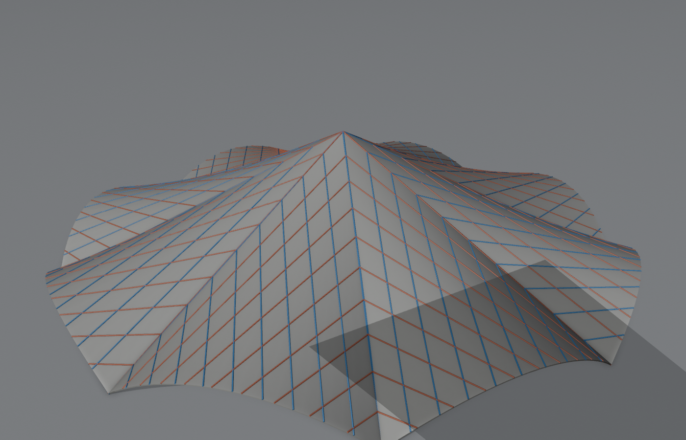 | 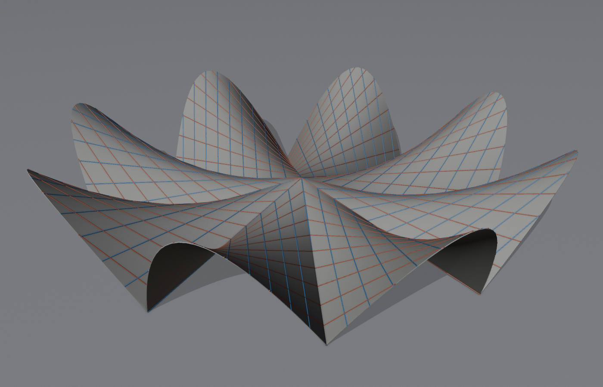 | 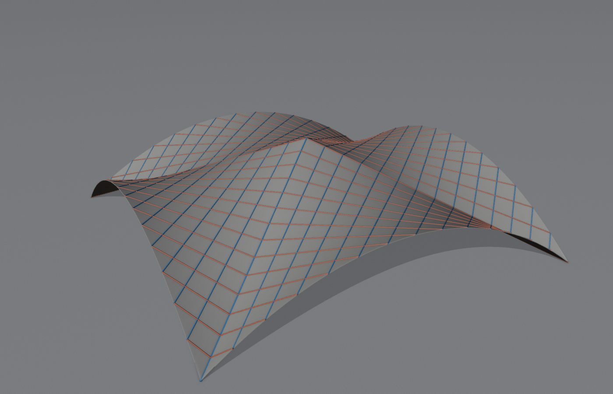 |

| Paraguas invertido | Paraguas normal | Paraguas inclinado |
|---|---|---|
| 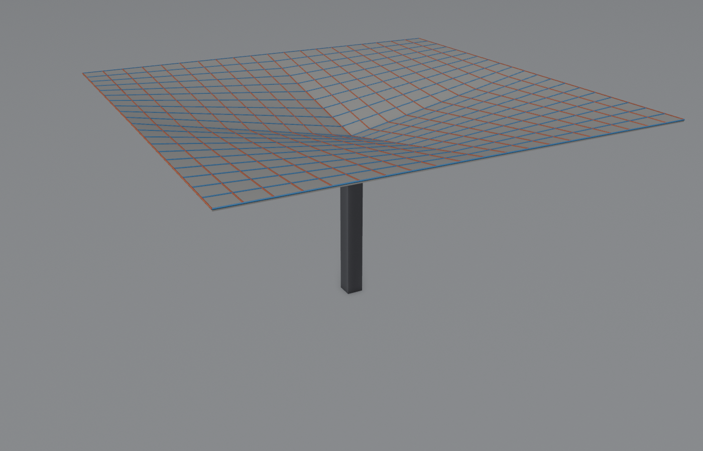 | 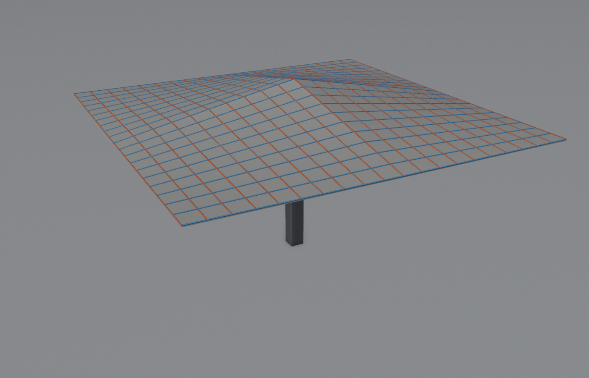 | 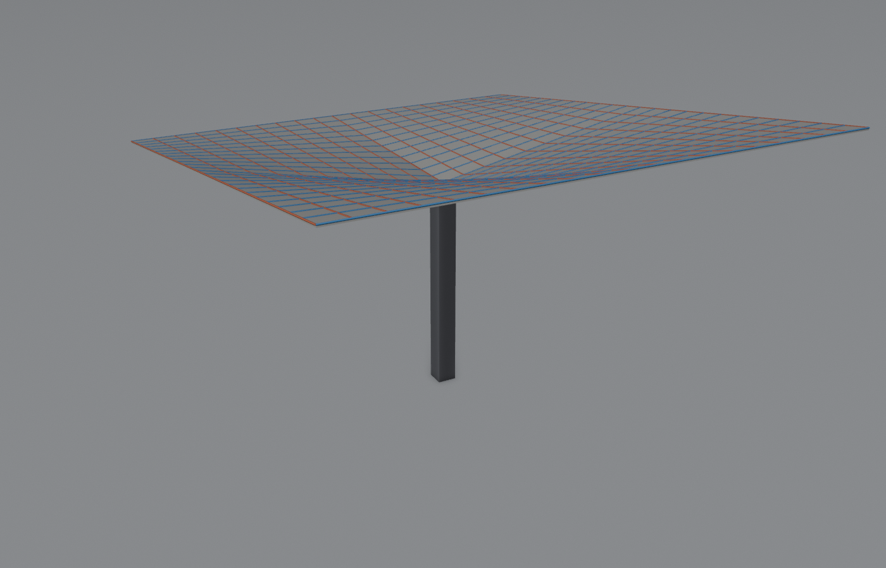 |

| Retícula de paraguas invertidos | Lucernarios (dientes de sierra) | Inclinación alterna |
|---|---|---|
| 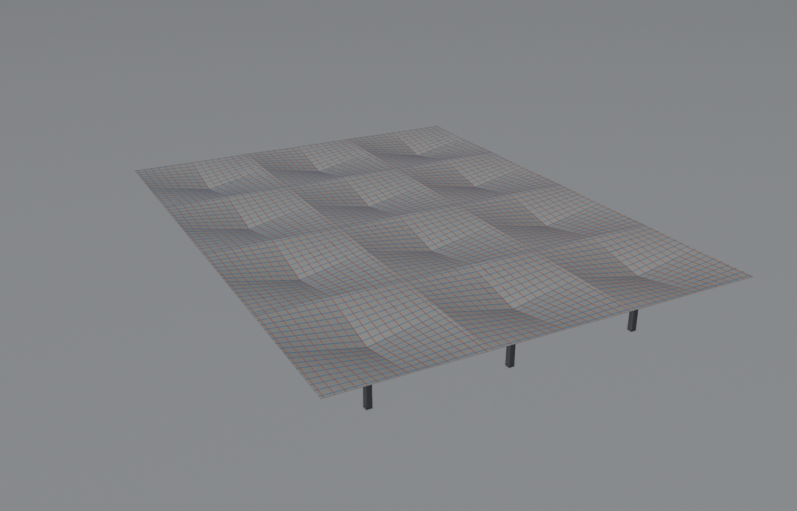 | 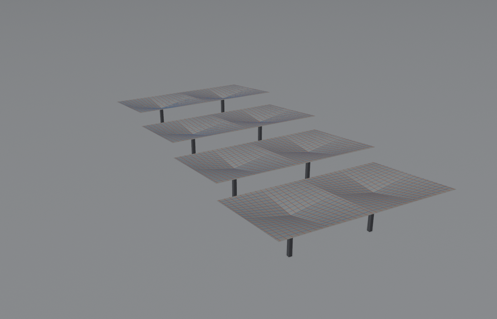 | 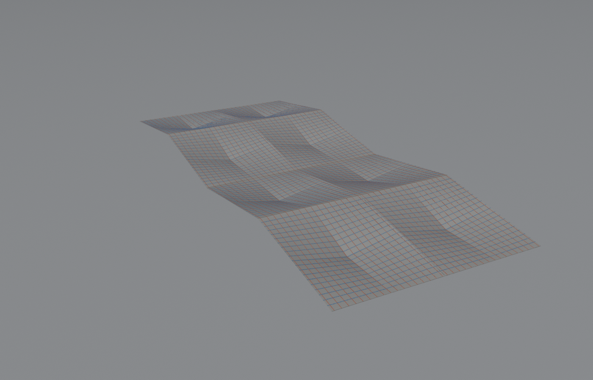 |

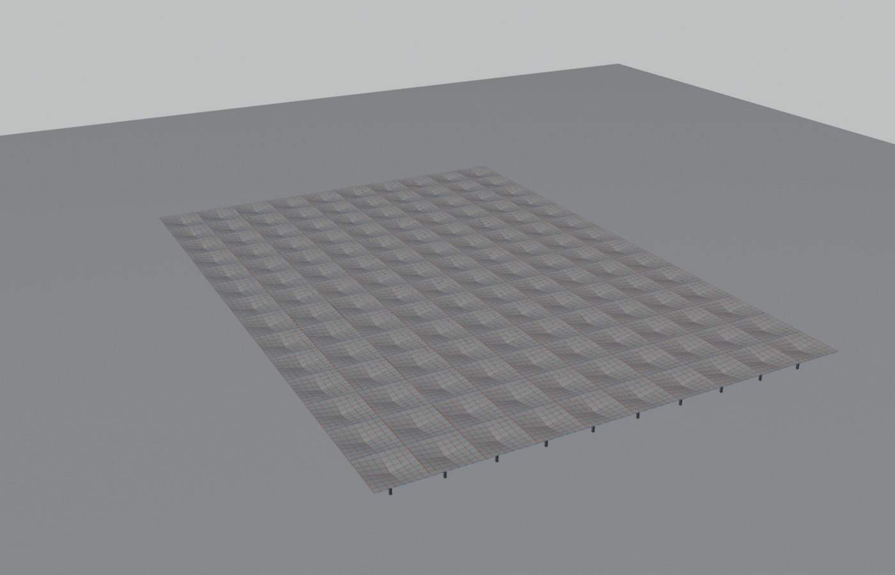

| Paraguas con nervios en los valles | Cúpula con nervios en las limas y viga en el borde libre |
|---|---|
| 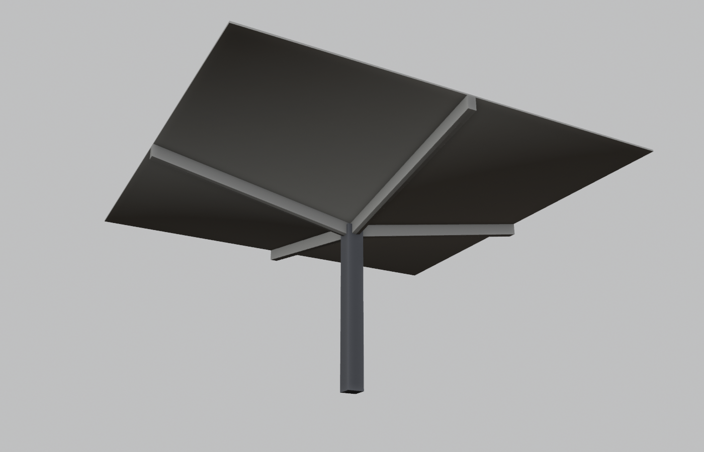 | 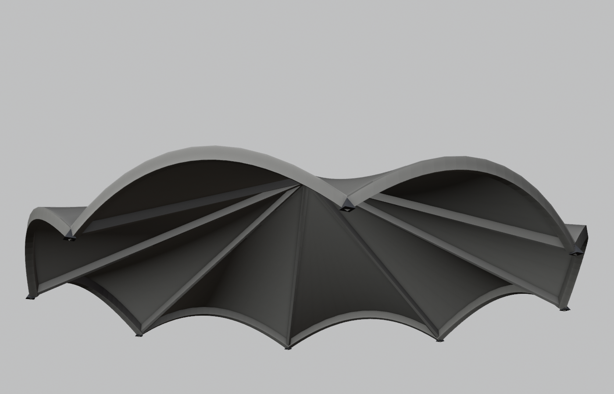 |

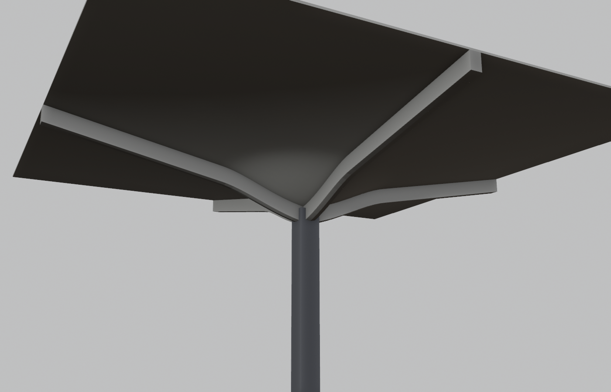

| Cimbra de la hypar (cascarón oculto) | Cimbra del paraguas vista desde abajo |
|---|---|
| 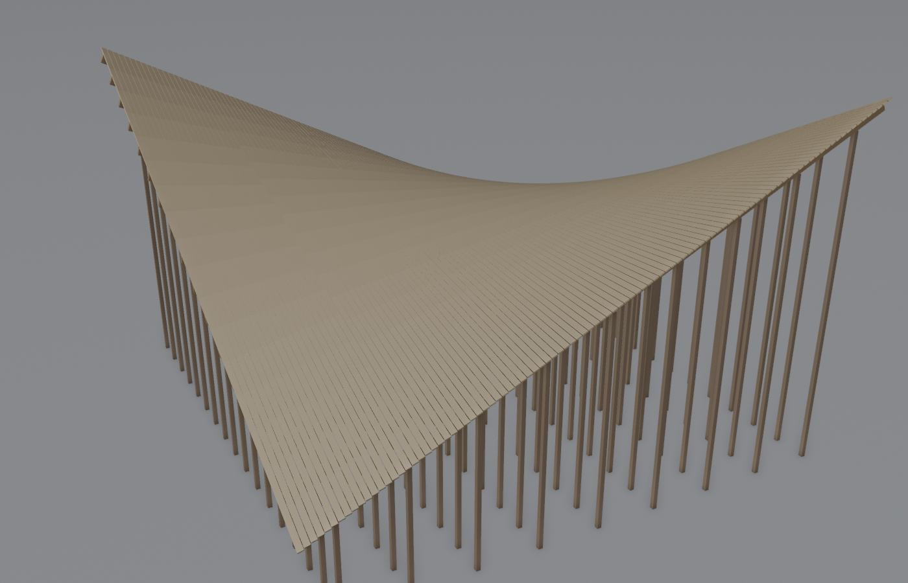 | 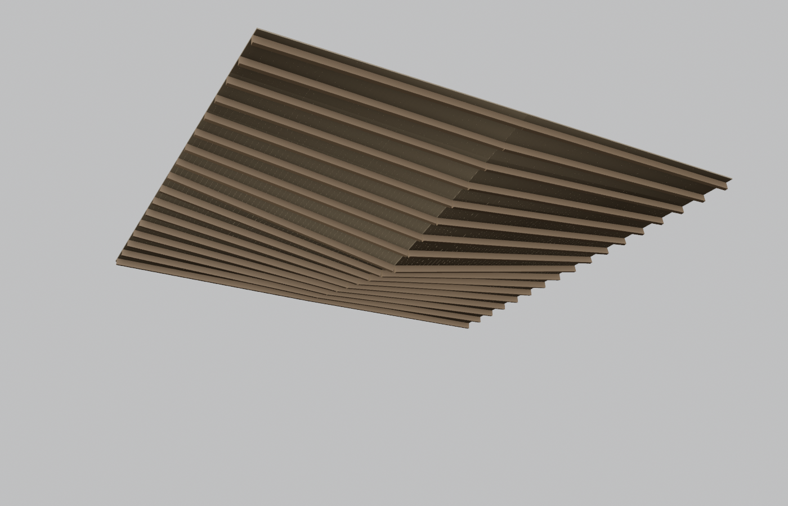 |

## Instalar

1. Blender > *Edit > Preferences > Get Extensions* > menú ⌄ (arriba a la derecha) > **Install from Disk…**
2. Elige `dist/candelalab-0.13.0.zip`. Queda instalado y activado; reemplaza cualquier versión anterior.

Para desarrollo, sin reinstalar después de cada cambio: copia o enlaza la carpeta `candelalab/` en
la carpeta de extensiones de usuario (`.../extensions/user_default/candelalab`) y usa
*F3 > Reload Scripts*.

Para volver a generar el ZIP:

```bash
blender --command extension build --source-dir candelalab --output-dir dist
```

## Usar

1. En la vista 3D pulsa **N** y abre la pestaña **CandelaLab**. También está en
   *Añadir (Shift+A) > Malla > Hypar*, *Bóveda radial*, *Paraguas* y *Retícula de paraguas
   (CandelaLab)*.
2. **Paraboloide hiperbólico**, **Bóveda radial (cúpula)**, **Paraguas (4 hypars)** o **Retícula de
   paraguas** crea el cascarón en el cursor 3D.
   El tipo también se puede cambiar después en el campo *Tipo*.
3. Cualquier cambio en un control regenera la geometría al instante:
   * **Geometría (hypar)**: luces, altura, alabeo, inclinación, bordes (rectos / parabólicos /
     ángulo libre) o definición por las cuatro alturas de esquina.
   * **Geometría (bóveda radial)**: número de lóbulos, radio (de la clave a los apoyos), tipo de borde
     libre (cilindro, plano vertical o plano inclinado), tres alturas (clave, vértice del borde y
     apoyos) y, con plano inclinado, el **vuelo** del borde. Los botones *Cúpula*,
     *Lóbulos (tipo Manantiales)* y *Bóveda por arista* cargan puntos de partida.
   * **Geometría (paraguas)**: luces X/Y, altura de la columna (centro), altura del borde e
     inclinación X/Y. Los botones *Invertido*, *Normal* e *Inclinado* cargan puntos de partida.
   * Común: espesor (normal o vertical) y qué cara es la superficie exacta; resolución y salida
     (sólido o superficie).
   * **Modularidad**: módulos en X e Y, juntas, patrón (uniforme o espejo en columnas, filas o
     ambas) y escalón por columna/fila. Los botones *Invertidos*, *Lucernarios* y *Alternos*
     cargan retículas de paraguas. Con 1 × 1 es un solo módulo. **Representación**:
     *Automática* (instancias por encima de 50 000 vértices), *Instancias* o *Geometría real*.
   * **Concepto estructural**: apoyos (disposición, tipo, desplante), vigas de borde (por lado en hypar
     y paraguas; en el borde libre en las bóvedas), capiteles, rigidizadores (nervios en las limas) y
     densidad.
   * **Cimbra** (casilla del encabezado): familia de las tablas, ancho y espesor de tabla, separación
     y sección de las vigas, separación de puntales, largo comercial y tolerancia. Muestra el
     resumen, el ajuste de las tablas a la hypar y los tipos de pieza.
   * **Análisis (FEA)**: tipo de elemento y refinamiento, material, columnas, cargas, factores de
     combinación, pandeo y salida (3D o 2D). *Revisar modelo* muestra nodos, apoyos, movimientos
     libres y totales de carga; *Exportar .inp* escribe el modelo.
   * **Resultados (FEA)**: *Cargar resultados (.frd)*, el paso o modo, la magnitud, los colores, la
     deformada y su escala.
   * **Visualización**: generatrices (separación y capa), normales, apoyos y mapas de pendiente,
     curvatura o altura. Para ver un mapa, pulsa «Ver mapa»; «Ver material» vuelve al color normal.
   * **Constructibilidad y métricas**: áreas, volúmenes, espesores, cimbra, limas, verificación de
     malla y comprobaciones.
   * **Variantes**: guarda y recupera configuraciones dentro del `.blend`.
   * **Exportar**: JSON con parámetros, ecuaciones por parche, métricas, superficie media para FEA
     (con conjuntos de nodos de bordes, limas y clave), generatrices, despiece de cimbra y, si se
     pide, el modelo FEA; el despiece en CSV para hoja de cálculo; y el modelo FEA en `.inp`.
4. Los parámetros también se pueden cambiar por script:
   `C.object.candela.radial_count = 6`, `C.object.candela.edge_height = 4.0`.
5. **Desplante** baja o sube el cascarón para que su punto más bajo toque el nivel del terreno.
   **Congelar** lo convierte en una malla normal.

## La bóveda radial en breve

Cada lóbulo k es una hypar de eje vertical, `z = H + c1·x' + c3·x'² + c5·y'²` en el sistema de su
eje, con `c5 = −c3 / tan²(π/N)`. Esa relación hace que las dos limas del lóbulo sean
**generatrices**: rectas en 3D, compartidas exactamente por los lóbulos vecinos. Toda la bóveda
sigue pudiendo cimbrarse con piezas rectas. `c1` y `c3` se despejan de las alturas de clave, borde y
apoyos.

* **Limas**: una misma lima puede ser cumbrera cerca de la clave y valle hacia el borde. Cambia
  donde las normales de los dos lóbulos coinciden. El informe mide la longitud de cada tipo y el
  ángulo entre normales.
* **Espesor con inglete**: en limas y clave el desfase usa el vector m con m·nᵢ = 1 para cada
  normal incidente, así el espesor es el mismo para los dos lóbulos. El volumen analítico
  (Steiner por lóbulo) se corrige con la cuña de inglete `σ·tan(δ/2)·(s1² − s0²)` por metro de lima.
  Las pruebas comprueban que esa corrección reduce el error frente a una malla fina en más de 10×.
* **Borde libre**, tres variantes:
  * Cilindro (planta circular): el borde es una curva alabeada.
  * Plano vertical (planta poligonal): el borde es un arco de parábola plano.
  * **Plano inclinado (tipo Manantiales)**: el plano contiene la recta entre los dos apoyos del
    lóbulo y pasa por el vértice del borde (altura de borde, a una distancia «vuelo» más allá de
    esa recta). El borde resulta un arco de **hipérbola plana**, así que su cimbra es plana. En
    planta también es una hipérbola y el lóbulo vuela sobre la línea de apoyos. El lóbulo es la
    región g = f − plano > 0. Sobre cada rayo desde la clave el borde es la raíz de una
    cuadrática, y sobre cada generatriz g es lineal, de modo que las generatrices terminan
    exactamente en el borde.

## El paraguas en breve

Cada cuadrante es la hypar de bordes rectos que interpola bilinealmente sus cuatro esquinas: la
cabeza de columna (altura z_c), los dos puntos medios de borde y la esquina exterior (los tres a la
altura del borde z_b). Con a = Lx/2, b = Ly/2, Δ = z_b − z_c y (sx, sy) los signos del cuadrante:

    z = z_c + Δ·(sx·x/a + sy·y/b − sx·sy·x·y/(a·b)) + p·x + q·y

* Los cuatro bordes de cada cuadrante son generatrices: los semiejes son **limas compartidas** por
  dos cuadrantes y el perímetro es recto (horizontal sin inclinación). Con Δ > 0 (invertido) las
  limas son valles y el agua baja por la columna; con Δ < 0 (normal) son cumbreras.
* La inclinación (p, q) suma un plano: siguen siendo hypars con las mismas generatrices y las limas
  siguen siendo continuas. Son los paraguas inclinados para iluminación cenital.
* Las generatrices son paralelas a los ejes, así que la malla alineada es **exacta** (error de
  cuerda 0) y con espesor vertical el volumen de la malla coincide con t·A a 1e-13. Los cuatro
  cuadrantes comparten una sola rejilla soldada, y en limas y columna el espesor lleva inglete.
* Las vigas de borde funcionan también aquí: la viga tiene un vértice donde cada lima llega al borde.

## La retícula en breve

El módulo se calcula **una sola vez**; la retícula es una lista de colocaciones: desplazamiento en
planta (centrado en el origen del objeto), escalón vertical y, según el patrón, reflexión en
columnas o filas alternas. Reflejar y trasladar no cambian áreas, volúmenes, curvaturas ni
pendientes, así que concreto, cimbra y peso son **exactamente N veces** los del módulo.

Lo que depende de la posición se recalcula:

* **Cotas**, el mapa de alturas (normalizado sobre toda la retícula) y el desplante.
* **Columnas**: cada una llega al desplante aunque su módulo esté escalonado.
* **Salto entre bordes contiguos**: la diferencia de altura entre bordes enfrentados de módulos
  vecinos. En una retícula de paraguas inclinados un ángulo α, el salto es 2·a·tan α (a = media
  luz). Es la altura de la banda de luz cenital: 1.90 m en el tipo *Lucernarios* (12 m, 9°). Con
  espejo en columnas alternas los bordes altos quedan enfrentados y el salto es 0.

Funciona con los tres tipos de cascarón, por ejemplo una hilera de bóvedas por arista. El JSON
exporta un módulo (su superficie media para FEA) y la lista de colocaciones.

### Instanciación con Geometry Nodes

Con instancias, el objeto guarda la malla de **un solo módulo** y un modificador de Geometry Nodes
(grupo compartido *CandelaLab · Instancias*) la repite:

* El grupo es: *Object Info* de un hijo «Colocaciones» (un vértice por módulo) → *Instance on Points*.
* La escala sale del atributo `candela_scale` = (±1, ±1, 1); la escala −1 hace el espejo.
* Generatrices, normales y vigas llevan el mismo modificador.
* Las columnas son geometría real: cada una llega al desplante y su longitud cambia con el escalón.
* Informes y totales son idénticos a los de la geometría real (lo comprueban las pruebas).

| Retícula de paraguas | Geometría real | Instancias |
|---|---|---|
| 8 × 6 = 48, malla 8 × 8 por cuadrante (27 744 vértices) | ~140 ms | (bajo el umbral: geometría real) |
| 10 × 10 = 100, malla 12 × 12 (125 000 vértices) | ~450 ms | ~30 ms |
| 40 × 40 = 1600, malla 12 × 12 (2 000 000 vértices) | no práctico | ~60 ms |

*Congelar* una retícula instanciada la convierte antes en geometría real. Con instancias, el mapa
de alturas es el de un módulo (todas las copias comparten la malla); pendiente y curvatura no
cambian al reflejar ni trasladar.

## Los rigidizadores en breve

En *Concepto estructural* hay dos tipos. Sus secciones las fija el usuario; no están dimensionadas.

* **Nervios en las limas.** Van bajo cada lima (los valles o cumbreras del paraguas y las aristas
  de las bóvedas), centrados en ella:
  * Son prismas verticales: la cara superior sigue el intradós y el fondo queda a «peralte» por
    debajo, así que el volumen es exactamente peralte × área en planta.
  * Cada nervio se arma en dos mitades, una por paño, para que su cara superior siga el pliegue.
  * Donde concurren varias limas (la clave o la cabeza de la columna), cada mitad se recorta por la
    bisectriz con la vecina: los nervios se unen sin solaparse.
  * Una hypar de un solo paño no tiene limas; se rigidiza con vigas de borde.
* **Viga en el borde libre de las bóvedas.** Es una franja hacia el interior desde el arco, la cuerda
  o la curva de corte inclinado, recortada en las limas. En planta poligonal forma un marco a inglete
  en cada esquina. Usa el ancho y el peralte de las vigas de borde.

Su volumen entra en el concreto, el peso y la cimbra (área de fondos y costados). En las retículas
se instancian como las vigas. El JSON los describe en `stiffeners`. En el modelo FEA son almas de
lámina:
* los nervios, centrados en la lima;
* la viga del borde libre, un anillo cerrado bajo el borde.

Las pruebas comparan sus volúmenes con fórmulas cerradas: la cruz de nervios del paraguas,
peralte·(ancho·(2a + 2b) − ancho²); los trapecios de la clave de la cúpula; la corona circular; y el
marco de la bóveda por arista.

### Capiteles

*Capiteles en los apoyos* engrosa el cascarón bajo cada apoyo:
* en la cabeza de la columna de un paraguas;
* en las esquinas o centros de borde apoyados de una hypar;
* en los arranques de las limas de una bóveda.

**Forma.** El espesor añadido es Δt(r) = Δ·(1 − (r/R)²)² hasta el radio R. Es suave: pendiente nula
en el centro y en el borde. El extradós no cambia; baja el intradós, según la misma dirección del
desfase (vertical, normal o el inglete de las limas). Columnas, nervios y vigas cuelgan del intradós
engrosado.

**Volumen.** Es exacto con el mismo modelo que el resto del cascarón:
* con espesor vertical, ∬ Δt dx dy;
* con espesor normal, la fórmula de Steiner punto a punto, más la cuña de inglete de las limas que
  pasan bajo el capitel;
* sólo dentro de la planta: un apoyo en una esquina recta suma un cuarto del disco, y uno en el
  centro de un borde, la mitad.

Las pruebas lo comparan con πΔR²/3 (apoyo interior) y sus fracciones. La malla converge a él: a 96
divisiones difiere 0.03–0.08 % en paraguas, cúpula y lóbulos.

**Modelo FEA.** La superficie media baja Δt/2 y el espesor por nodo crece en Δt, así que las caras
del modelo coinciden con las del sólido (y con las que lee la salida 3D).

**Comprobaciones.** Avisan si la malla es gruesa para el radio, si el desfase normal se acerca al
radio de curvatura, si dos capiteles se solapan, y que la cimbra del despiece no incluye el cajón
del capitel.

## El despiece de cimbra en breve

Candela cimbraba con madera recta porque el intradós de una hypar contiene dos familias de rectas.
El panel **Cimbra** arma ese despiece en los tres tipos de cascarón:

* **Tablas** sobre una familia de generatrices (A o B), una junto a otra, separadas en planta su
  propio ancho.
* **Vigas** sobre la otra familia, ancladas en el origen. Así cae una viga sobre cada lima que pasa
  por él, como los valles del paraguas. Van bajo las tablas.
* **Puntales** verticales repartidos a lo largo de cada viga hasta el desplante, cortados de 5 en
  5 cm (el resto se ajusta con cuñas).

De cada pieza se calcula, con la geometría exacta de su generatriz:

| Dato | Qué significa |
|---|---|
| Largo del eje y largo de corte | El de corte es la arista más larga, con los extremos cortados contra el borde o la lima. |
| Esviaje de cada extremo | Ángulo del corte en el plano tangente (0° = a escuadra). Dos generatrices que en planta se cruzan a 90° forman otro ángulo en el espacio. |
| Giro | La normal gira alrededor de la generatriz (la hypar no es desarrollable): la tabla tiene que torcerse. Con ancho b, una esquina queda b·sen φ fuera del plano de las otras tres. |
| Holgura entre tablas | Las generatrices de una familia son paralelas en planta pero se cruzan en el espacio. Separadas en planta el ancho b, la distancia 3D entre ejes es ≥ b: nunca se solapan y se abren hacia los bordes. |

Por ejemplo, en la hypar de bordes rectos de 12 × 12 m con 3 m de alabeo y tablas de 10 cm: esviaje
de 11.5° en las esquinas, giro de hasta 53° de punta a punta y holgura de hasta 11.8 mm entre
tablas. Las pruebas comparan estos valores con sus fórmulas cerradas.

Las piezas se agrupan en **tipos**: largo redondeado a la tolerancia y esviajes al grado; una pieza
girada o volteada es la misma. También se calculan las **piezas comerciales** necesarias (mejor
ajuste decreciente, con empalmes en las piezas más largas) y la madera en m³ y pies-tablón. Las
comprobaciones avisan si la holgura supera la tolerancia o si algún puntal no cabe.

En una retícula el despiece es **un juego** que se traslada de módulo en módulo, como hacía Candela
con los paraguas. Se dibuja en el primer módulo y no se instancia.

**Exportar despiece (CSV)** escribe el resumen, los tipos y cada pieza con su identificador
(`T03-12`, `V02-4`, `P05-1`) y sus coordenadas. Por defecto usa coma decimal y «;», para hojas de
cálculo en español. El JSON incluye el mismo despiece.

Con la cimbra visible, la regeneración tarda ~30 ms en el paraguas y ~0.3 s en la bóveda de lóbulos
de 18 m de radio (unas 1000 tablas).

## El modelo de elementos finitos en breve

El panel **Análisis (FEA)** arma la entrada de un análisis y la exporta en formato CalculiX/Abaqus
(`.inp`). [CalculiX](http://www.calculix.de) es libre; PrePoMax lo abre con interfaz gráfica. Para
calcular: `ccx -i modelo` (sin la extensión). Los resultados quedan en `modelo.frd` y las
reacciones en `modelo.dat`. El JSON puede incluir el mismo modelo (casilla *Incluir modelo FEA*).

**Malla.** Lámina en la superficie media:

* **Cuadrática** (por defecto): S8R, y S6 en el abanico de la clave de las bóvedas. Se malla a doble
  resolución y cada bloque de 2 × 2 celdas da un elemento, así que también los nodos intermedios
  están sobre la superficie exacta, incluidas limas y bordes curvos.
* **Lineal**: S4/S3.

Hay un refinamiento de 1 a 4 sobre las divisiones del cascarón. El espesor es constante con espesor
normal; con espesor vertical se escribe por nodo como t·cos α (primer orden).

**Apoyos**, tomados de *Concepto estructural*. Cada apoyo restringe los nodos de su huella (el
cuadrado de lado *Tamaño*):

* Articulado: traslaciones.
* Empotrado: traslaciones y giros.
* Columna: viga vertical B32/B31 hasta el desplante, empotrada o articulada en la base, o sin
  columna (empotra la huella).

Las vigas de borde son un alma de lámina, del ancho de la viga, colgada bajo el borde desde la
superficie media hasta su fondo. Así tienen su excentricidad vertical y comparten nodos con el
cascarón.

**Cargas.** Las magnitudes y los factores son datos tuyos; por defecto sólo hay peso propio.

| Caso | Qué es |
|---|---|
| PP | Peso propio (`*DLOAD GRAV`): el programa integra la masa con la densidad. |
| CM | Carga muerta adicional por m² de superficie, vertical. |
| CV y CV_MEDIA | Carga viva por m² en planta, en toda la planta y en media planta (x > 0): los cascarones son sensibles a las cargas asimétricas. |
| PRESION | Presión normal uniforme, positiva hacia el intradós. |
| COMB y COMB_MEDIA | γ permanentes · (PP + CM) + γ variables · CV (o CV_MEDIA). |

Las cargas repartidas se escriben como fuerzas nodales consistentes, ∫ q·Nᵢ dA sobre cada elemento,
igual que haría el programa con una carga distribuida. En los S8R las esquinas pueden llevar fuerzas
de signo contrario, y es correcto. Cada caso es un paso `*STATIC` y cada combinación tiene además un
paso `*BUCKLE`.

**Comprobaciones** (geométricas, antes de calcular):

* **Mecanismo**: cuántos movimientos de sólido rígido dejan libres los apoyos. Dos apoyos articulados
  puntuales, por ejemplo, permiten girar alrededor de la recta que los une. Un paraguas con la
  columna articulada en la base tiene 3.
* **Conectividad** del modelo.
* **Peso del modelo frente al analítico.**
* **Totales de cada caso**: van en el panel y en la cabecera del `.inp`; las reacciones del `.dat`
  (`*NODE PRINT, TOTALS=ONLY`) deben valer lo mismo con signo contrario.

**Límites.**

* **Pandeo lineal**: sobreestima la carga crítica de un cascarón delgado, que es muy sensible a las
  imperfecciones. Sus factores no son una capacidad; hace falta un análisis no lineal con
  imperfecciones.
* **Unión columna–cascarón**: es un nodo, así que las tensiones locales en la cabeza no son
  representativas.
* **Retículas**: se exporta un módulo.

### Resultados (.frd) sobre el cascarón

Después de calcular, *Cargar resultados (.frd)* en el panel **Resultados (FEA)** lee el `.frd` y,
si existe, el `.dat` del mismo nombre.

* **Qué se muestra**: el paso o modo de pandeo y la magnitud. Hay desplazamiento |U| y vertical
  (mm), von Mises, y tensión principal máxima y mínima (MPa, tracción positiva). Los colores van en
  el atributo `candela_fea` y el valor numérico en `candela_fea_valor` (visible en la hoja de cálculo
  de Blender). *Ver mapa* los muestra en el visor.
* **Esfuerzos por unidad de longitud**: además de las tensiones están N₁, N₂, Nx, Ny y Nxy (kN/m) y
  M₁, M₂, Mx, My y Mxy (kN·m/m). Se obtienen de las tensiones de las dos caras en cada punto de la
  lámina:
  * en ejes del plano tangente (x = proyección del X global, y = n × x);
  * con distribución lineal en el espesor t: N = t·(σ_ext + σ_int)/2 y M = t²/12·(σ_ext − σ_int);
  * N > 0 es tracción y M > 0 tracciona el extradós;
  * N₁, N₂, M₁ y M₂ son los valores principales, que no dependen de los ejes;
  * con salida 2D hay N pero no M, porque CalculiX ya promedió en el espesor.

  *Exportar N y M (CSV)* escribe, para el resultado elegido, una fila por nodo de la lámina con
  posición, espesor, los diez esfuerzos y el ángulo θN1 de la dirección de N₁ (desde x hacia y).
* **Direcciones principales de N**: cruces sobre el cascarón, en el objeto hijo «Direcciones de N».
  * Cada cruz tiene un brazo según la dirección de N₁ y otro según la de N₂, que son perpendiculares,
    de longitud proporcional a |N|. θ₁ = ½·atan2(2·Nxy, Nx − Ny) en los ejes locales.
  * Tracción en rojo con puntas hacia fuera; compresión en azul con puntas hacia dentro. La forma
    distingue el signo aunque no se vea el color. Sobre el mapa de color se leen peor: para verlas
    con claridad, desactiva *Colorear el cascarón*.
  * Hay una cruz por celda de una rejilla en planta, en el nodo más cercano al centro de la celda.
    *Separación* es el lado de la celda (0 = 1/16 del lado mayor de la planta).
  * *kN/m por metro* fija la escala (0 = automática: el brazo mayor mide el 90 % de la separación).
    Fíjala para comparar dos resultados. La leyenda indica la escala usada.
  * Los brazos siguen la superficie: cada vértice es un punto del extradós y del intradós (con el
    capitel), o de la superficie de referencia si la salida es *Superficie*, separado un cuarto del
    espesor. No se hunden en un cascarón curvo ni al cruzar una lima. Se recortan en el borde de la
    planta.
  * No se dibujan los brazos con |N| menor que el 2 % del máximo (la leyenda dice cuántos). Los modos
    de pandeo no traen esfuerzos.
* **Deformada**: copia de un módulo desplazada, en el objeto hijo «Deformada». Con escala 0 el máximo
  se dibuja como el 5 % del tamaño. En una retícula, la deformada y las direcciones se dibujan en el
  primer módulo, el que se exporta.
* **Salida 3D o 2D** (se elige al exportar, en el panel Análisis):
  * 3D es lo predeterminado en CalculiX para láminas. Escribe los nodos de la lámina expandida, con
    números nuevos, en las caras superior e inferior. Cada vértice del intradós y del extradós toma
    el nodo expandido más cercano, así que cada cara muestra su tensión, con la flexión.
  * 2D promedia en el espesor sobre los nodos originales: sólo membrana. Los nodos se asocian por
    número y se comprueban sus coordenadas.
* **Pandeo**: el factor de cada modo sale del `.dat`, donde CalculiX siempre lo escribe, o, si no hay
  `.dat`, del `.frd`. El modo se muestra normalizado (máximo 1).
* **Reacciones**: las totales del `.dat` (`NAPOYOS`) se comparan con los totales de carga del modelo,
  paso a paso.
* **Validez**: los resultados quedan ligados a los parámetros. Si cambia algo que afecta al modelo
  (geometría, malla, apoyos, cargas), los colores, la deformada y las direcciones se ocultan y el panel
  lo indica. Los cambios de vista, cimbra o retícula no los invalidan; pasar de *Sólido* a *Superficie*
  vuelve a asociar los vértices. Si los vértices del cascarón no encuentran
  nodos en el `.frd`, la carga se rechaza: es de otra geometría.
* **Archivos**: el `.frd` no se copia al `.blend`. Se guarda la ruta y se relee al cambiar de
  resultado tras abrir el archivo.

## Verificar

```bash
python -m unittest discover -s tests -v
```

```bash
blender --background --factory-startup --python tests/blender_smoke_test.py
```

```bash
blender --background --factory-startup --python tests/render_previews.py -- docs
```

Con un segundo argumento (por ejemplo `-- docs cimbra`) sólo genera las imágenes cuyo nombre empieza así.

```bash
blender --factory-startup --python tests/blender_ui_test.py -- captura.png
```

* La primera prueba valida el núcleo sin Blender (157 pruebas: 22 de la hypar, 13 de la bóveda, 9
  del corte inclinado, 11 del paraguas, 17 de la retícula, 4 de ellas de instanciación, 22 de la
  cimbra, 16 del modelo FEA, 18 de la lectura de resultados, 12 de los rigidizadores, 8 de los
  capiteles y 9 de las direcciones de N). La lectura de resultados se prueba
  con archivos `.frd` y `.dat` sintéticos, escritos con los formatos documentados de CalculiX
  (`tests/frd_fixture.py`). Comprueba:
  * columnas fijas con números pegados («1-1.23450E-03»), formato corto y continuaciones;
  * la salida 2D por número de nodo y la 3D por cercanía (cada cara con su valor);
  * los pasos, los modos de pandeo y los factores del `.dat`;
  * el cotejo de reacciones, el rechazo de resultados de otra geometría y los tensores principales;
  * N y M exactos, con sus principales, a partir de caras con membrana y flexión conocidas en los ejes
    locales de cada punto;
  * que la salida 2D dé N sin M, y el CSV.

  En las direcciones de N comprueba:
  * que d₁ y d₂ diagonalicen el tensor, sean unitarias, tangentes y formen un triedro con la normal;
  * una cruz por celda, en el nodo más cercano a su centro, con la rejilla centrada;
  * los valores y el ángulo de un campo de membrana conocido, y el ángulo del CSV;
  * que cada vértice esté exactamente en su cara más la separación (espesor vertical, salida
    *Sólido* y *Superficie*), también bajo un capitel;
  * el recorte en el borde y en una esquina, la escala automática y la fija, y los casos sin dibujo
    (pandeo, N nula, N₂ = 0).

  No ha podido probarse con un `.frd` real de CalculiX. En el modelo FEA relee el `.inp` con un lector propio,
  independiente del escritor, y comprueba:
  * que los nodos (también los intermedios) estén sobre la superficie media exacta;
  * el número de nodos y elementos, la orientación, que no haya nodos sueltos y las referencias a
    conjuntos;
  * que cada paso lleve exactamente los totales de su caso (q·área, q·planta, la mitad, presión =
    p·área proyectada, combinaciones);
  * el espesor por nodo, la detección de mecanismos, la columna, el alma de las vigas, la bóveda con
    triángulos en la clave, la retícula y el JSON.

  No hay un solver CalculiX en el equipo donde se desarrolló: el formato sigue la sintaxis de
  CalculiX/Abaqus, pero no se ha ejecutado con él.

  En la cimbra compara largos, largos de corte, giros, esviajes y holguras con sus
  fórmulas cerradas en z = 3 + 0.1·x·y. También comprueba que las tablas no se solapen, la simetría
  de tipos del paraguas, la viga única sobre cada lima, el corte comercial y los empalmes, la malla
  cerrada con el volumen de la madera, la retícula con un solo juego y el CSV. En la retícula comprueba el paso y
  el centrado, los patrones, totales exactamente N veces el módulo, normales hacia afuera en las
  copias reflejadas, el salto 2·a·tan α, las columnas hasta el suelo con escalonamiento, el mapa
  de alturas global, la exportación y la retícula con bóvedas e hypars. En el paraguas comprueba alturas, bordes horizontales,
  limas rectas y continuas (también inclinado), valles/cumbreras, error de cuerda nulo, volumen
  exacto, corrección de inglete, vigas, exportación y que la columna nunca atraviese el cascarón. En la bóveda comprueba alturas exactas, que las limas sean rectas y
  compartidas, el área en planta, la malla soldada y cerrada, el volumen exacto con espesor
  vertical, la corrección de inglete, las generatrices sobre los lóbulos y el JSON. En el corte
  inclinado comprueba:
  * que el borde esté a la vez sobre la hypar y sobre su plano, que arranque en los apoyos y llegue
    al vértice;
  * la derivada del borde frente a diferencias finitas y el área frente a un polígono de 4000 lados;
  * que las generatrices terminen en el borde o en las limas;
  * el volumen de la malla y los casos imposibles.
* La segunda es la integración dentro de Blender, con las tres familias, la retícula y su
  instanciación. En el *depsgraph* evaluado comprueba número de instancias, posiciones, espejo
  (determinante −1), columnas reales, cambio de modo, congelado y que las instancias sigan
  funcionando tras guardar y reabrir. En la cimbra comprueba el hijo «Cimbra» con sus tres
  materiales, que su malla sea la del núcleo, que los puntales lleguen al desplante, el CSV y el
  JSON, un solo juego sin instanciar en la retícula y el congelado. En el modelo FEA comprueba
  revisar y exportar desde los operadores, los 8 pasos, que los nodos del `.inp` sean los del núcleo,
  que el resumen caduque al cambiar un dato y el JSON. En los resultados carga un `.frd` sintético y
  comprueba:
  * los colores y la flexión en cada cara, las reacciones y el factor de pandeo;
  * la deformada y la relectura del archivo;
  * las direcciones de N: el hijo con sus materiales, la tracción uniaxial sin brazo de N₂, que vayan
    sobre las caras, el primer módulo de la retícula (real e instanciada) y el modo de pandeo sin
    esfuerzos;
  * que se reasocien al pasar a *Superficie*;
  * que se oculten al cambiar la geometría y vuelvan al restaurarla.

  También: operadores, actualización en
  vivo, tipos predefinidos, variantes, exportar e importar, duplicados y persistencia en el
  `.blend`. También dibuja todos los paneles sobre un layout simulado que valida propiedades,
  operadores, iconos y tipos de argumentos. Termina con «OK: 0 fallos».
* La tercera genera las imágenes de arriba sin abrir la interfaz.
* La cuarta (opcional) abre la interfaz de Blender unos segundos y guarda una captura.

## Limitaciones conocidas

* Los nervios sólo van bajo las limas; no hay nervios sobre generatrices. El despiece de cimbra no
  incluye la de vigas, nervios ni capiteles.
* El capitel tiene un solo perfil (suave y circular en planta). El área de cimbra del intradós no
  cuenta el abombamiento del capitel. Los capiteles no pueden solaparse.
* Con corte inclinado, el canto del sólido sigue la normal de la superficie (coherente con la fórmula
  de Steiner) y no el plano de corte. Con 4 cm de espesor la diferencia es de milímetros.
* El tipo *Lóbulos (tipo Manantiales)* es un punto de partida tipológico, no un levantamiento de la
  obra.
* Con instancias no se puede editar a mano cada módulo: para eso hay que *Congelar*, que pasa la
  retícula a geometría real.
* Las juntas son separaciones geométricas: no se detallan juntas, canalones ni la carpintería de las
  bandas de luz.
* El despiece de cimbra **no dimensiona** la cimbra: secciones, separaciones y largos los fija el
  usuario y su resistencia y rigidez no se verifican. Tampoco se ubican los empalmes sobre las vigas.
  Las tablas de los bordes, que pueden quedar de ancho parcial, se listan enteras. Las vigas de borde
  de concreto no se cimbran.
* Las direcciones de N son cruces en puntos, no trayectorias continuas (isostáticas). En una retícula
  sólo se dibujan en el primer módulo. Un brazo recortado en el borde no muestra su longitud entera.
* La lectura de `.frd` sólo admite el formato ASCII (el predeterminado), no el binario. Está probada
  con archivos sintéticos que siguen el formato documentado, no con salidas reales de CalculiX: si
  un `.frd` real no carga, el mensaje indica qué no coincide.
* El modelo FEA no está resuelto ni validado con un solver en este desarrollo. El alma de las vigas
  de borde va centrada bajo el borde (se ignora su desplazamiento en planta, medio ancho hacia
  dentro). No se generan coeficientes de viento ni de nieve de ninguna normativa.
* La regeneración tarda ~15 ms (paraguas), ~30 ms (hypar 32×32) y ~100 ms (bóveda de 8 lóbulos); es Python puro.
* Con espesor normal y una referencia distinta del intradós, la parte superior de las vigas usa una
  aproximación de primer orden de la altura del intradós.
* **Nada en CandelaLab indica seguridad estructural.** Todas las cifras son geométricas o
  cuantificaciones (peso propio). Cualquier diseño requiere análisis estructural (incluido el pandeo)
  y la revisión de un ingeniero.

## Licencia

GPL-3.0-or-later (la licencia que exige Blender a sus extensiones). Texto completo en
[LICENSE](LICENSE).
